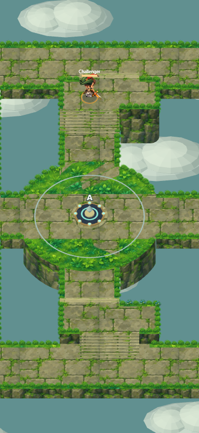
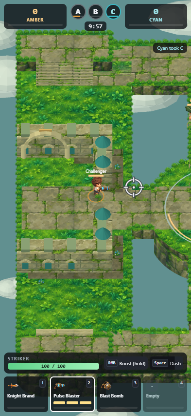
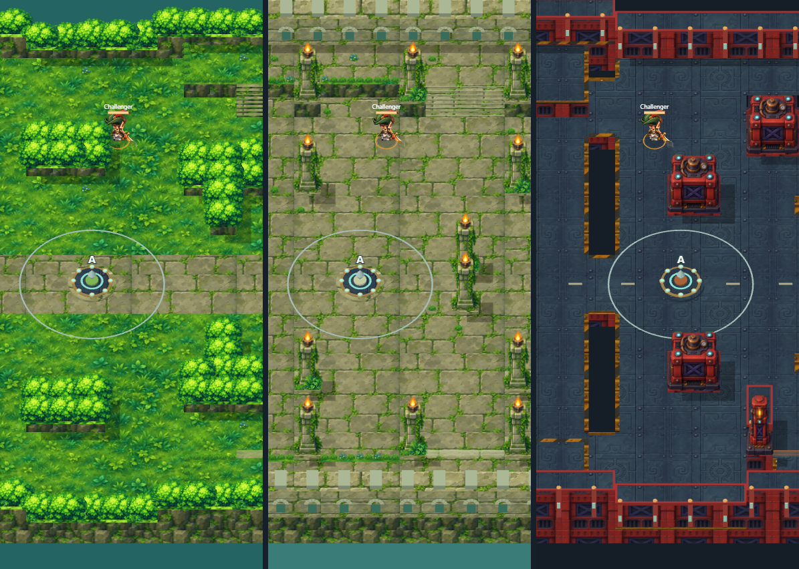
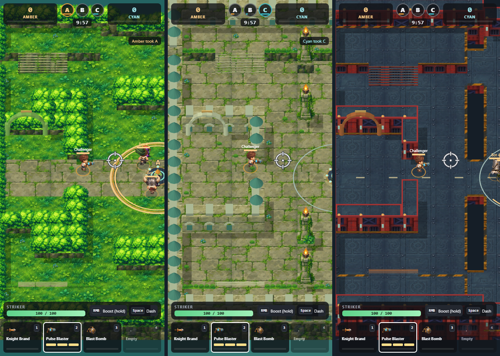
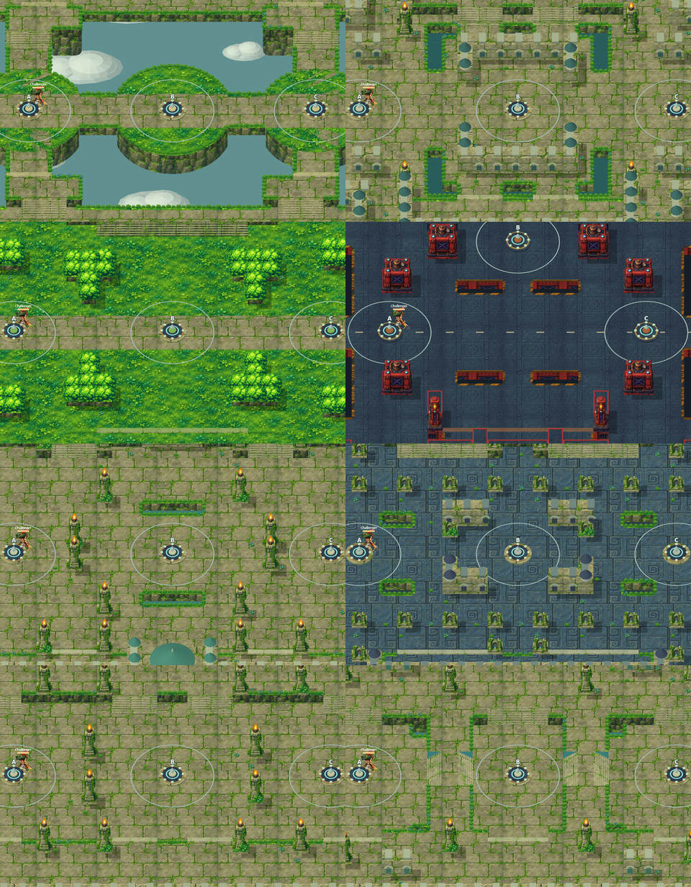

# Lockdown 3D arenas

Lockdown renders all eight arenas with a **north-up** elevated camera: world north is screen up and east-west routes remain horizontal. It shares mesh primitives with Semag's voxel games, with painted materials and depth-tested scenery matching the approved garden, overgrown-ruins and red-foundry direction. Adjacent wall cells merge into continuous structures. Stairs are solid flights meeting their real low and high landings.

The approved [art-direction mockup](screenshots/lockdown/approved-art-direction.png) is a concept image. The other screenshots on this page are renders from the implemented game. Future changes to the visual direction should begin with a few quick mockups for user feedback before implementation, as requested by the user.

The new runtime kit contains nine painted materials and eight transparent scenery sprites: grass, rooted hedges, ferns, flowers, mossy paving, rock faces, vine-covered shrines and torch pillars, engraved metal flooring, red machinery and lit industrial posts. Original source PNGs and exact generation prompts are tracked under `tools/art-source/lockdown-painted-*`; generation used the built-in image tool. `tools/lockdown-build-painted-art.mjs` packs the production atlases into `public/assets/lockdown/painted/` (about 2.6 MiB). Padded power-of-two atlases, mipmaps and explicit texture gradients keep detail stable at phone scale. When gradient extensions are unavailable, the renderer uses linear filtering.

Sky Bridges uses authored rounded islands and bridge polygons in `public/lockdown-map-surfaces.js`. The same polygon union defines visible ground and body collision. Internal joins have no curb across the route. The coarse grid remains for bot navigation, heights and spawn-room cover. Both teams retain mirrored routes to all three capture points, and specialized shoes retain their ability to cross pits.

Stair flights are at least three tiles wide (144 world units), with a full-width upper landing and two tiles of clear approach below. Sky Bridges' main crossing, outer loops and island links are also 144 units wide. The labyrinth has spaced hedge islands and broad paths; the keep's moat entrances, foundry bridges and base approaches are wider. These changes use the same map data for rendering, collision and bot navigation; the knight's collision radius is unchanged.

`public/lockdown-world-mesh.js` constructs the static world. `lockdown-painted-mesh.js` supplies material indices without changing the shared voxel renderer. `lockdown-world-dressing.js` anchors decorative foliage and illustrated props to that geometry; substantial props occupy existing blocked footprints. `lockdown-world-view.js` uploads the scene once per map, with a three-map GPU cache, static scenery atlas and bounded character atlas. `lockdown-voxel-renderer.js` presents the original animated knight/equipment sprites with depth testing, compact illuminated capture mechanisms and combat overlays. A faint local silhouette preserves visibility behind tall cover.

`lockdown-camera.js` defines the common projection for the WebGL scene, labels, effects and mouse picking. Movement and dashes use the same north-up basis; the server validates the movement angle. The capture ring still represents the actual 132-unit radius, while the solid monument is 88 units across. Portrait framing shows 480 world units across so the painted detail and knights remain legible. The render target follows Semag's 2.2-million-pixel budget. Hardware context loss switches to the existing Canvas renderer and context restoration rebuilds the GPU resources, including painted textures.

## Art and fallback

The earlier coordinated scene kit remains available to the Canvas fallback: 107 regenerated environment and landmark PNGs across six themes. The source paintings and exact prompts are in `tools/art-source/lockdown-*.png` and `tools/art-source/lockdown-prompts.json`; they were created with the built-in image generation tool. The build script packs the materials and transparent props at their declared anchors, preserves alpha and validates all 319 runtime sprites at native or double resolution. The fallback also uses the rounded Sky Bridges ground outline.

## Rebuild and check

```sh
npm ci
npm run art:lockdown
npm run art:lockdown:painted
npm run test:lockdown
```

With the server running on port 3128 (or `LOCKDOWN_URL` set to another server):

```sh
npm run preview:lockdown
node tools/lockdown-browser-smoke.mjs
```

The scripts use an installed Chrome browser. The deterministic fixture renders all eight arenas, waits for the production painted assets, checks WebGL errors and tests context loss/restoration. The live smoke test starts matches through the actual lobby, uses keyboard/mouse movement and combat, and checks HUD bounds at 1280 x 820, 393 x 852 and 320 x 720, including phone matches in the garden, ruins and foundry. These are browser viewport checks, not tests on physical iPhones.

The regression suite checks GPU/HUD/picking agreement at different elevations, screen-relative movement, bounded finite mesh geometry, all stair landings, actual off-centre climbing and descending through every stair lane, two knights passing on Sky Bridges routes, rounded-edge collision, bridge traversal, pit shoes, bot connectivity, multiplayer input, sprite dimensions and alpha. Voxel and Shinobi renderer tests guard the shared mesh export.










